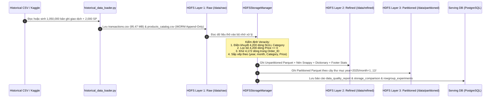
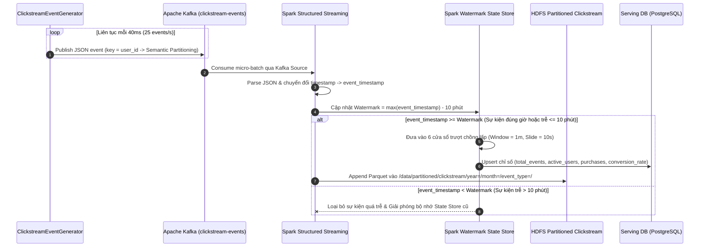
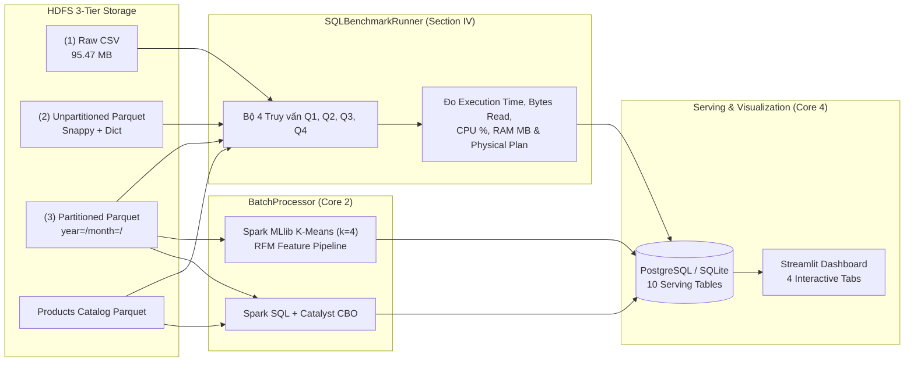

# 📘 BÁO CÁO CHI TIẾT DỰ ÁN: LÝ THUYẾT, CÔNG CỤ, PHƯƠNG PHÁP TRIỂN KHAI, CẤU TRÚC MÃ NGUỒN VÀ LUỒNG HOẠT ĐỘNG

**ĐẠI HỌC BÁCH KHOA HÀ NỘI**  
**TRƯỜNG CÔNG NGHỆ THÔNG TIN VÀ TRUYỀN THÔNG (SoICT)**  
**HỌC PHẦN: IT4931 — LƯU TRỮ VÀ XỬ LÝ DỮ LIỆU LỚN**

- **Tên đề tài:** Hệ thống Đường ống Dữ liệu Thương mại Điện tử Thời gian thực (*Real-Time E-Commerce Data Pipeline*)
- **Giảng viên hướng dẫn:** TS. Vũ Tuyết Trinh
- **Nhóm thực hiện:** Nhóm 3
  1. **Phạm Văn Quyết** — MSSV: `202416331`
  2. **Vũ Việt Tiến** — MSSV: `202416362`
  3. **Nguyễn Xuân Hồng Quân** — MSSV: `202416321`
  4. **Đặng Minh Quân** — MSSV: `202416323`

---

## MỤC LỤC
1. [Phần 1: Bài Toán Nghiệp Vụ & Mô Hình 5V Của Dữ Liệu Lớn](#phần-1-bài-toán-nghiệp-vụ--mô-hình-5v-của-dữ-liệu-lớn)
2. [Phần 2: Cơ Sở Lý Thuyết Cốt Lõi (Tổng Hợp Từ Học Phần IT4931)](#phần-2-cơ-sở-lý-thuyết-cốt-lõi-tổng-hợp-từ-học-phần-it4931)
3. [Phần 3: Hệ Sinh Thái Công Cụ & Công Nghệ Sử Dụng](#phần-3-hệ-sinh-thái-công-cụ--công-nghệ-sử-dụng)
4. [Phần 4: Chức Năng Cụ Thể Của Từng Thư Mục, File, Class Và Hàm](#phần-4-chức-năng-cụ-thể-của-từng-thư-mục-file-class-và-hàm)
5. [Phần 5: Luồng Hoạt Động Chi Tiết Của Hệ Thống (End-to-End Workflows)](#phần-5-luồng-hoạt-động-chi-tiết-của-hệ-thống-end-to-end-workflows)
6. [Phần 6: Phương Pháp Thực Hiện & Quy Trình Vận Hành](#phần-6-phương-pháp-thực-hiện--quy-trình-vận-hành)
7. [Phần 7: Kết Quả Thực Nghiệm & Đánh Giá Hiệu Năng](#phần-7-kết-quả-thực-nghiệm--đánh-giá-hiệu-năng)

---

## Phần 1: Bài Toán Nghiệp Vụ & Mô Hình 5V Của Dữ Liệu Lớn

### 1.1. Bối cảnh và Mục tiêu Đề tài
Trong các nền tảng thương mại điện tử quy mô lớn, dữ liệu phát sinh từ hai nguồn có tính chất hoàn toàn khác biệt:
1. **Dữ liệu giao dịch lịch sử (*Batch Transaction Data*):** Tập dữ liệu đơn hàng có quy mô hàng triệu bản ghi tích lũy theo thời gian, đòi hỏi khả năng lưu trữ nén tối ưu trên đĩa, quét tuần tự thông lượng cao và phân tích chuyên sâu (doanh thu dài hạn, biên lợi nhuận sản phẩm, phân khúc khách hàng).
2. **Dữ liệu hành vi người dùng thời gian thực (*Streaming Clickstream Data*):** Luồng sự kiện tương tác (`view`, `cart`, `remove_from_cart`, `purchase`) phát sinh liên tục từng mili-giây với khả năng đến muộn (*out-of-order / late data*) do độ trễ mạng di động, đòi hỏi cơ chế xử lý luồng theo thời gian sự kiện (*Event-Time*) với độ trễ thấp.

**Mục tiêu cốt lõi của dự án:**
- Xây dựng kiến trúc đường ống dữ liệu **Lambda Architecture** kết hợp cả xử lý theo lô (**Batch Processing**) và xử lý theo luồng (**Stream Processing**) trên nền tảng lưu trữ phân tán **HDFS**.
- Tổ chức lưu trữ thành **3 phân tầng trên HDFS**: `Raw Data Layer` (CSV/JSON bất biến) $\rightarrow$ `Refined Data Layer` (định dạng cột **Apache Parquet** + nén **Snappy** + *Dictionary Encoding*) $\rightarrow$ `Partitioned Data Layer` (phân vùng theo `year=/month=/` và `event_type=`).
- Thiết kế và thực thi **Kế hoạch Thực nghiệm Benchmark SQL** nhằm định lượng chính xác hiệu quả của **Predicate Pushdown**, **Partition Pruning**, và **Kích thước Row Group (`parquet.block.size`)** qua 4 chỉ số: *Thời gian thực thi (Execution Time)*, *Dung lượng dữ liệu quét (Scan Volume / Bytes Read)*, *Mức sử dụng CPU*, và *Mức tiêu thụ RAM*.

### 1.2. Hiện thực hóa 5 Đặc trưng Big Data (Mô hình 5V)
| Đặc trưng 5V | Bài toán & Dữ liệu trong Dự án | Thách thức Kỹ thuật | Giải pháp Kiến trúc trong Dự án |
|---|---|---|---|
| **1. Volume** *(Dung lượng)* | **1,050,000 bản ghi** giao dịch lịch sử (`95.47 MB` CSV thô) + bảng danh mục `2,000` sản phẩm + nhật ký Clickstream. | Chi phí lưu trữ cao, quét toàn bộ tệp (`Full Table Scan`) gây nghẽn I/O đĩa. | Lưu trữ trên **HDFS** (`Block = 128MB`), chuyển sang định dạng cột **Parquet** + nén **Snappy** + sắp xếp khóa (*Sort-on-Write*), giảm dung lượng từ `95.47 MB` xuống **`19.16 MB – 27.76 MB`** (nén **3.44x – 4.98x**). |
| **2. Velocity** *(Tốc độ)* | Luồng sự kiện Clickstream (`25–100 events/s`) phát sinh liên tục từ ứng dụng web/mobile. | Xử lý gần thời gian thực mà không làm nghẽn hệ thống lưu trữ hay mất mát sự kiện khi tải tăng đột biến. | Dùng **Apache Kafka** (`clickstream-events`, 3 Partitions) làm bộ đệm phân tách Producer/Consumer, kết hợp **Spark Structured Streaming** với **Cửa sổ trượt 1 phút, trượt 10 giây**. |
| **3. Variety** *(Đa dạng)* | Kết hợp bảng giao dịch **CSV** có cấu trúc chặt chẽ và nhật ký **JSON** bán cấu trúc từ luồng sự kiện. | Sự không đồng nhất về định dạng (*heterogeneity*) và kiểu dữ liệu khi phân tích hợp nhất. | Chuẩn hóa lược đồ (*Schema Enforcement*) tại bước chuyển từ `Raw Layer` sang `Refined Layer` dưới định dạng nhị phân hướng cột **Parquet** thống nhất. |
| **4. Veracity** *(Độ tin cậy)* | Dữ liệu thô chứa bản ghi khuyết thiếu (`NULL Category`), giá âm (`Price <= 0`), trùng mã đơn (`Order_ID`), và sự kiện luồng đến trễ (*Late Data*). | Dữ liệu bẩn làm sai lệch thống kê doanh thu; dữ liệu luồng đến trễ không giới hạn làm tràn bộ nhớ *State Store*. | Khử nhiễu tự động tại tầng `Refined` (lọc bỏ `8,372` bản ghi lỗi, điền khuyết `4,200` bản ghi) và áp dụng **Watermarking 10 phút** trên Spark Streaming để xử lý *Late Data* và dọn dẹp *State Store*. |
| **5. Value** *(Giá trị)* | Trích xuất tri thức kinh doanh phục vụ ra quyết định tức thời và chiến lược dài hạn. | Kết hợp góc nhìn lịch sử chính xác với góc nhìn thời gian thực độ trễ thấp. | Tổng hợp *Batch Views* (Doanh thu, Top 10 SP, **Phân cụm khách hàng RFM bằng Spark MLlib K-Means**) và *Speed Views* (Phễu chuyển đổi, Active Users/phút) vào **PostgreSQL** và trực quan hóa trên **Streamlit Dashboard**. |

---

## Phần 2: Cơ Sở Lý Thuyết Cốt Lõi (Tổng Hợp Từ Học Phần IT4931)

Toàn bộ thiết kế của hệ thống được xây dựng dựa trên nền tảng lý thuyết của học phần **IT4931 — Lưu trữ và Xử lý Dữ liệu Lớn** (TS. Vũ Tuyết Trinh):

### 2.1. Kiến trúc Dữ liệu Lớn Lambda Architecture (*Bài giảng Note 8*)
Theo *Note 8 - Big Data Architecture*, hệ sinh thái Hadoop truyền thống giải quyết tốt **Volume** và **Variety** nhưng có độ trễ cao, không đáp ứng được **Velocity**. **Lambda Architecture** giải quyết bài toán này bằng cách chia hệ thống thành 3 tầng độc lập (*Separation of Concerns*):
1. **Batch Layer (Tầng Xử lý Khối):**
   - Quản lý tập dữ liệu gốc bất biến (**Master Dataset — Data Immutability**): dữ liệu chỉ được ghi nối thêm (*Append-only*), không bao giờ bị ghi đè hay xóa sửa trực tiếp.
   - **Khả năng tính toán lại (*Re-computation Capability*):** Nếu phát hiện lỗi trong mã nguồn (*human fault-tolerance*) hoặc cần bổ sung chỉ số phân tích mới, hệ thống có thể chạy lại toàn bộ tập dữ liệu gốc trên HDFS để tái tạo *Batch Views* chính xác 100%.
2. **Speed Layer (Tầng Xử lý Luồng):**
   - Bù đắp độ trễ hàng giờ của Batch Layer bằng cách xử lý luồng dữ liệu mới phát sinh theo thời gian thực (*incremental stream processing*), tạo ra các *Real-time Views* với độ trễ chỉ vài giây.
3. **Serving Layer (Tầng Phục vụ & Nhất quán Cuối cùng — Eventual Consistency):**
   - Lưu trữ, lập chỉ mục và hợp nhất kết quả từ cả *Batch Views* (nhất quán mạnh nhưng có độ trễ) và *Real-time Views* (cập nhật tức thời), đảm bảo tính **Eventual Consistency** và áp dụng nguyên lý **Polyglot Persistence** (dùng HDFS/Parquet cho lưu trữ phân tích tuần tự và PostgreSQL cho truy vấn điểm/tổng hợp độ trễ thấp).

### 2.2. Hệ thống Tệp Phân tán HDFS (*Bài giảng Note 2 & Note 3*)
Theo *Note 3 - Hadoop Storage (HDFS)*:
- **Kiến trúc Master/Slave:**
  - **NameNode (Master):** Quản lý không gian tên hệ thống tệp (*File System Namespace*), cây thư mục và ánh xạ `File -> Blocks -> DataNodes`. Toàn bộ siêu dữ liệu (*Metadata*) được lưu giữ trực tiếp trong bộ nhớ **RAM** của NameNode để phục vụ tra cứu cực nhanh, đồng thời được ghi bền vững xuống đĩa qua `FsImage` và `EditLog (Transaction Log)`.
  - **DataNode (Slave):** Lưu trữ các khối dữ liệu vật lý (*Blocks*) trên đĩa cục bộ kèm mã kiểm tra toàn vẹn **CRC32 Checksum** (tính cho mỗi `512 bytes`). DataNode gửi tín hiệu **Heartbeat** mỗi `3 giây` và **Block Report** định kỳ về NameNode.
- **Mô hình truy cập Write-Once-Read-Many (WORM):**
  - Tệp trên HDFS chỉ ghi một lần (hoặc ghi nối thêm *append-only*) và đọc nhiều lần với thông lượng đọc tuần tự cao, loại bỏ hoàn toàn chi phí khóa đồng bộ phức tạp (*lock contention*).
- **Kích thước Khối (Block Size = 128 MB) & Bài toán Tệp Nhỏ (*Small Files Problem*):**
  - HDFS chia tệp lớn thành các khối `128 MB` (`dfs.blocksize = 134217728 bytes`) để giảm thiểu số lượng mục siêu dữ liệu trong RAM của NameNode và giảm chi phí thiết lập kết nối mạng.
  - Nếu hệ thống lưu hàng chục nghìn tệp nhỏ vài KB (ví dụ ghi từng sự kiện streaming thành 1 file riêng lẻ), bộ nhớ RAM của NameNode sẽ nhanh chóng bị cạn kiệt. Do đó, dự án sử dụng `coalesce()` / `repartition()` và gom theo cửa sổ trước khi ghi Parquet xuống HDFS.

### 2.3. Định dạng Lưu trữ Hướng cột Apache Parquet & Nén Snappy (*Bài giảng Note 3 - Slide 41–43*)
Khác với định dạng lưu trữ theo dòng (`CSV`, `JSON`) buộc phải đọc toàn bộ các cột của từng dòng từ đĩa, **Apache Parquet** tổ chức dữ liệu theo cấu trúc phân cấp hướng cột:
1. **Row Group (`parquet.block.size`):** Tệp Parquet được chia theo chiều ngang thành các *Row Groups* (mặc định `128 MB`). Khi đặt `parquet.block.size = 128 MB` bằng đúng `dfs.blocksize = 128 MB` của HDFS, mỗi Row Group nằm gọn trong đúng một HDFS Block trên một DataNode duy nhất, tối ưu hóa **Data Locality** (tránh phải đọc nối mạng qua 2 DataNode để ghép 1 Row Group).
2. **Column Chunk & Page (`parquet.page.size = 1 MB`):** Trong mỗi Row Group, dữ liệu của từng cột được lưu liền kề nhau thành một *Column Chunk*, chia nhỏ thành các *Pages* (`1 MB`). Nhờ đó, khi truy vấn chỉ cần 3/9 cột (**Column Projection**), hệ thống chỉ đọc đúng 3 *Column Chunks* đó, bỏ qua 6 cột còn lại.
3. **Dictionary Encoding & Run-Length Encoding (RLE):** Các cột có tập giá trị lặp lại nhiều như `Category` (12 danh mục), `Order_Status` (5 trạng thái), `Brand` được mã hóa thành số nguyên qua từ điển (`parquet.enable.dictionary = true`) và nén dãy lặp RLE trước khi nén khối bằng thuật toán **Snappy (`parquet.compression = SNAPPY`)**.
4. **Footer Statistics & Cơ chế Predicate Pushdown (`PushedFilters`):** Ở cuối mỗi tệp và mỗi Row Group, Parquet lưu thống kê `min`, `max`, `null_count` cho từng cột. Khi câu lệnh SQL có điều kiện `WHERE Price > 650.0`, bộ đọc Parquet kiểm tra ngay `max(Price)` của từng Row Group; nếu `max(Price) <= 650.0`, toàn bộ Row Group đó được bỏ qua ngay ở tầng lưu trữ mà không cần giải nén!
5. **Partition Pruning (`PartitionFilters`):** Khi dữ liệu được phân vùng theo cấu trúc thư mục Hive (`year=2025/month=11/`), câu lệnh `WHERE year = 2025 AND month = 11` giúp Spark Catalyst Optimizer chỉ quét duy nhất thư mục `month=11`, loại bỏ ngay `11/12` (~`91.6%`) dữ liệu của các tháng khác.

### 2.4. Hệ thống Nhắn tin Phân tán Apache Kafka (*Bài giảng Note 5*)
Theo *Note 5 - Distributed Message Queue (Kafka)*:
- **Topic & Partition Commit Log:** Topic `clickstream-events` được chia thành **3 Partitions**. Mỗi Partition là một tệp nhật ký tuần tự bất biến (*ordered, immutable append-only commit log*), trong đó mỗi bản ghi được gán một số thứ tự duy nhất gọi là **Offset**.
- **Bảo toàn thứ tự với Semantic Partitioning (*Slide 15 & 23*):** Kafka chỉ bảo đảm thứ tự thông điệp **bên trong cùng một Partition**, không bảo đảm thứ tự giữa các Partition khác nhau. Vì vậy, dự án thiết lập khóa bản ghi Kafka là `key = user_id` (*Semantic Partitioning*), đảm bảo toàn bộ chuỗi hành vi `view -> cart -> purchase` của cùng một khách hàng luôn đi vào cùng một Partition theo đúng thứ tự thời gian thực tế.
- **Độ bền ghi (*Durable Writes — Slide 22*):** Producer cấu hình `acks = 'all'` (`request.required.acks = -1`), yêu cầu Partition Leader và tất cả các *In-Sync Replicas (ISRs)* xác nhận đã ghi vào log trước khi hoàn tất, đảm bảo không mất thông điệp.

### 2.5. Xử lý Phân tán với Apache Spark: Batch SQL, MLlib & Structured Streaming
- **Spark SQL, Catalyst Optimizer & Cost-Based Optimizer (CBO):**
  - Biểu diễn dữ liệu qua `DataFrame` với cơ chế thực thi lười biếng (*Lazy Evaluation*).
  - **Catalyst Optimizer** tự động đẩy điều kiện lọc xuống nguồn (*Filter Pushdown*), cắt tỉa cột (*Column Pruning*) và cắt tỉa phân vùng (*Partition Pruning*).
  - **Cost-Based Optimizer (`spark.sql.cbo.enabled = true`)** kết hợp **Adaptive Query Execution (`spark.sql.adaptive.enabled = true`)** tự động lựa chọn chiến lược nối bảng tối ưu (như `BroadcastHashJoin` khi nối bảng `transactions` >1M dòng với bảng `products_catalog` 2,000 dòng).
- **Spark Structured Streaming: Event-Time, Sliding Window & Watermarking:**
  - Xử lý dựa trên **Event-Time** (`event_timestamp` trích xuất từ trường `timestamp` bên trong gói tin JSON).
  - **Sliding Window (`1 phút`, trượt mỗi `10 giây`):** Mỗi sự kiện hợp lệ được ánh xạ vào 6 cửa sổ trượt chồng lấp nhau có độ rộng 60 giây.
  - **Watermarking (`10 phút`):** Duy trì ngưỡng  $$\text{Watermark}_t = \max(\mathtt{event\_timestamp}) - 10\text{ minutes}$$. Các sự kiện đến trễ dưới 10 phút vẫn được cập nhật vào cửa sổ cũ; các sự kiện trễ trên 10 phút bị loại bỏ và trạng thái cửa sổ cũ được giải phóng khỏi RAM (*State Store Cleanup*).

---

## Phần 3: Hệ Sinh Thái Công Cụ & Công Nghệ Sử Dụng

| Tầng Kiến Trúc | Công Cụ / Thư Viện | Phiên Bản | Vai Trò Trong Hệ Thống |
|---|---|---|---|
| **Đóng gói Hạ tầng** | **Docker & Docker Compose** | Compose `v3.8` | Đóng gói và điều phối đồng bộ 9 dịch vụ container cô lập qua mạng nội bộ `ecommerce-bigdata-net`. |
| **Tầng Thu thập (Ingestion)** | **Apache Zookeeper** | `confluentinc/cp-zookeeper:7.5.0` | Quản lý cấu hình cụm Kafka, bầu chọn Partition Leader và theo dõi trạng thái Broker. |
| **Tầng Thu thập (Ingestion)** | **Apache Kafka** | `confluentinc/cp-kafka:7.5.0` | Hệ thống hàng đợi thông điệp phân tán quản lý topic `clickstream-events` (3 Partitions). |
| **Tầng Thu thập (Ingestion)** | **Python `kafka-python-ng`** | `2.2.x` | Thư viện Kafka Producer bất đồng bộ gửi luồng sự kiện Clickstream kèm khóa `user_id`. |
| **Tầng Lưu trữ (Storage)** | **Apache Hadoop HDFS** | `Hadoop 3.2.1` (`bde2020`) | Hệ thống tệp phân tán gồm `hdfs-namenode-service` (port `9870`/`9000`) và `hdfs-datanode-service` (`Block=128MB`, `Replication=1`). |
| **Định dạng Lưu trữ** | **Apache Parquet & PyArrow** | `PyArrow` + `Snappy` | Lưu trữ hướng cột nhị phân, nén khối Snappy, mã hóa từ điển và lưu thống kê Footer `min/max`. |
| **Tầng Xử lý (Processing)** | **Apache Spark (PySpark)** | `Spark 3.5.1` (`bitnami/spark`) | Cụm `spark-master-service` & `spark-worker-service` thực thi Spark SQL Batch, Spark MLlib K-Means và Spark Structured Streaming. |
| **Tầng Phục vụ (Serving)** | **PostgreSQL & SQLite Fallback** | `PostgreSQL 15-alpine` / `SQLAlchemy` | Lưu trữ các bảng *Batch Views*, *Real-time Speed Views*, và kết quả thực nghiệm *Benchmark SQL*. |
| **Tầng Trực quan hóa** | **Streamlit & Plotly** | `Streamlit` + `Plotly Express/GO` | Xây dựng Dashboard tương tác 4 Tab hiển thị biểu đồ thời gian thực và kết quả Benchmark. |
| **Kiểm thử & Đo lường** | **Pytest & Psutil** | `Pytest` + `Psutil` | Kiểm thử tự động toàn trình và đo lường tài nguyên phần cứng (CPU %, RAM MB) khi chạy Benchmark. |

---

## Phần 4: Chức Năng Cụ Thể Của Từng Thư Mục, File, Class Và Hàm

### 4.1. Sơ đồ Cây Thư mục Toàn Dự án
```text
d:\IT4931\
├── docker-compose.yml             # Định nghĩa 9 dịch vụ container phân theo 5 tầng kiến trúc
├── hadoop.env                     # Biến môi trường cấu hình core-site.xml & hdfs-site.xml cho HDFS
├── pyproject.toml                 # Cấu hình metadata gói Python và đường dẫn kiểm thử pytest
├── requirements.txt               # Danh sách thư viện phụ thuộc của dự án
├── README.md                      # Tài liệu giới thiệu tổng quan và hướng dẫn chạy nhanh
├── docker/                        # Các Dockerfile đóng gói dịch vụ tùy chỉnh
│   ├── Dockerfile.generator       # Image cho dịch vụ sinh sự kiện Clickstream đẩy vào Kafka
│   ├── Dockerfile.spark           # Image Spark 3.5.1 tích hợp thư viện Python & PostgreSQL JDBC jar
│   └── Dockerfile.dashboard       # Image cho ứng dụng giao diện Streamlit Dashboard
├── sql/
│   └── init.sql                   # Lược đồ DDL khởi tạo 10 bảng và chỉ mục trên PostgreSQL
├── src/                           # Mã nguồn chính của hệ thống (Chia theo 4 khối cốt lõi)
│   ├── __init__.py
│   ├── config.py                  # Quản lý cấu hình tập trung (HDFS, Parquet, Kafka, Streaming, DB)
│   ├── ingestion/                 # CORE 1A: Tầng Thu thập Dữ liệu
│   │   ├── __init__.py
│   │   ├── historical_data_loader.py  # Sinh / chuyển đổi >1M bản ghi CSV lịch sử & danh mục SP
│   │   └── event_generator.py         # Sinh luồng sự kiện Clickstream thời gian thực & Late Data
│   ├── storage/                   # CORE 1B: Tầng Lưu trữ Phân tán HDFS & Parquet
│   │   ├── __init__.py
│   │   └── hdfs_storage_manager.py    # Chuyển đổi Raw -> Refined -> Partitioned & thực nghiệm Row Group
│   ├── batch/                     # CORE 2: Tầng Xử lý Khối (Spark SQL & MLlib)
│   │   ├── __init__.py
│   │   └── batch_processor.py         # Tính toán doanh thu, Top 10 SP, trạng thái đơn & K-Means RFM
│   ├── streaming/                 # CORE 3: Tầng Xử lý Luồng (Spark Structured Streaming)
│   │   ├── __init__.py
│   │   ├── stream_processor.py        # Xử lý cửa sổ trượt 1m/10s và Watermarking 10 phút
│   │   └── run_spark_stream_job.py    # Entrypoint chạy job Spark Structured Streaming trên cụm
│   ├── benchmark/                 # PHẦN IV: Thực nghiệm Benchmark SQL
│   │   ├── __init__.py
│   │   └── sql_benchmark.py           # Thực thi 4 truy vấn SQL đối chứng 3 kiến trúc lưu trữ
│   ├── serving/                   # CORE 4A: Tầng Phục vụ Dữ liệu (PostgreSQL / SQLite)
│   │   ├── __init__.py
│   │   └── db_client.py               # Client kết nối CSDL hỗ trợ tự động chuyển đổi PostgreSQL/SQLite
│   └── dashboard/                 # CORE 4B: Tầng Trực quan hóa (Streamlit)
│       ├── __init__.py
│       └── app.py                     # Ứng dụng Streamlit Dashboard gồm 4 Tab phân tích chuyên sâu
├── scripts/                       # Các kịch bản điều phối tự động
│   ├── run_local_demo.py          # Chạy trọn vẹn đường ống >1M bản ghi & Benchmark bằng 1 lệnh
│   └── submit_spark_jobs.sh       # Nạp dữ liệu lên HDFS và submit job lên cụm Spark trong Docker
├── notebooks/                     # Notebook phân tích & thuyết trình
│   └── IT4931_Ecommerce_Analysis_and_Benchmark.ipynb
├── tests/                         # Bộ kiểm thử tự động
│   └── test_pipeline.py           # Kiểm thử tích hợp toàn trình 7 giai đoạn
└── docs/                          # Thư mục báo cáo học thuật & tài liệu thiết kế
    ├── BAO_CAO_CHI_TIET_DU_AN_IT4931.md  # Báo cáo tổng hợp chi tiết toàn dự án (File hiện tại)
    ├── ARCHITECTURE_AND_THEORY.md        # Chuyên khảo lý thuyết học phần IT4931
    └── EXPERIMENTAL_REPORT.md            # Báo cáo số liệu kết quả thực nghiệm trên 1,050,000 bản ghi
```

---

### 4.2. Giải thích Chi tiết Từng File Cấu hình Hạ tầng

#### 1. [`docker-compose.yml`](file:///d:/IT4931/docker-compose.yml)
- **Chức năng:** Định nghĩa và liên kết 9 dịch vụ container độc lập vận hành trên mạng bridge `ecommerce-bigdata-net` với cơ chế kiểm tra sức khỏe (`healthcheck` và `depends_on: condition: service_healthy`) để đảm bảo thứ tự khởi động:
  1. `zookeeper` (cổng `2181`): Điều phối cụm Kafka.
  2. `kafka-service` (cổng `9092`, `29092`): Kafka Broker tự động khởi tạo topic `clickstream-events` với `KAFKA_NUM_PARTITIONS: 3`.
  3. `event-generator-service`: Chạy [`src/ingestion/event_generator.py`](file:///d:/IT4931/src/ingestion/event_generator.py) liên tục đẩy 25 sự kiện/giây vào Kafka.
  4. `hdfs-namenode-service` (cổng Web UI `9870`, IPC `9000`): Quản lý namespace và metadata của HDFS.
  5. `hdfs-datanode-service` (cổng `9864`): Lưu trữ các khối dữ liệu vật lý HDFS.
  6. `spark-master-service` (cổng Web UI `8080`, RPC `7077`, App UI `4040`): Điều phối cụm tính toán Apache Spark.
  7. `spark-worker-service` (cổng `8081`, cấu hình `4 Cores`, `4GB RAM`): Thực thi các Executor cho cả tác vụ Batch và Streaming.
  8. `postgresql-service` (cổng `5432`): Cơ sở dữ liệu tầng Serving, tự động chạy [`sql/init.sql`](file:///d:/IT4931/sql/init.sql) khi khởi tạo.
  9. `streamlit-dashboard-service` (cổng `8501`): Giao diện trực quan hóa kết nối tới `postgresql-service`.

#### 2. [`hadoop.env`](file:///d:/IT4931/hadoop.env)
- **Chức năng:** Truyền các tham số cấu hình XML của Hadoop (`core-site.xml` và `hdfs-site.xml`) vào container NameNode và DataNode:
  - `CORE-SITE.XML_fs.defaultFS=hdfs://hdfs-namenode-service:9000`: Định nghĩa URI gốc của hệ thống tệp phân tán.
  - `HDFS-SITE.XML_dfs.blocksize=134217728`: Thiết lập kích thước khối HDFS đúng bằng **128 MB** (`134,217,728 bytes`).
  - `HDFS-SITE.XML_dfs.replication=1`: Thiết lập hệ số nhân bản bằng `1` cho môi trường thực nghiệm Docker cục bộ.

#### 3. [`sql/init.sql`](file:///d:/IT4931/sql/init.sql)
- **Chức năng:** Định nghĩa lược đồ cơ sở dữ liệu tầng Serving gồm **10 bảng** chia thành 3 nhóm:
  - **Nhóm bảng Batch Layer:**
    - `batch_revenue_summary`: Doanh thu, tổng số đơn, đơn hoàn tất, đơn hủy, giá trị đơn trung bình (AOV), số khách hàng duy nhất theo `(year, month, category)` (có đánh chỉ mục `idx_batch_rev_ym`, `idx_batch_rev_cat`).
    - `batch_top_products`: Top 10 sản phẩm có doanh thu cao nhất kèm thương hiệu, số lượng bán và biên lợi nhuận (`profit_margin_pct`).
    - `batch_order_status_summary`: Thống kê số lượng, tỷ lệ % và tổng giá trị theo 5 trạng thái đơn hàng.
    - `batch_customer_segments`: Kết quả phân cụm khách hàng RFM bằng thuật toán K-Means (`segment_id, segment_name, customer_count, avg_recency_days, avg_frequency_orders, avg_monetary_spend, share_of_revenue_pct`).
    - `data_quality_report`: Báo cáo kết quả làm sạch dữ liệu thô (*Veracity*).
  - **Nhóm bảng Speed Layer:**
    - `streaming_window_metrics`: Lưu chỉ số tổng hợp của từng cửa sổ trượt 1 phút trượt 10 giây (`window_start, window_end, total_events, active_users, active_sessions, view_count, cart_count, remove_cart_count, purchase_count, gross_sales, conversion_rate_pct, late_events_accepted, late_events_dropped`).
    - `streaming_category_metrics`: Lưu phân bố sự kiện thời gian thực theo từng danh mục và loại sự kiện.
  - **Nhóm bảng Thực nghiệm Benchmark SQL:**
    - `benchmark_results`: Lưu kết quả thực thi 4 câu truy vấn SQL trên 3 kiến trúc lưu trữ (12 dòng kết quả kèm kế hoạch thực thi vật lý `physical_plan_snippet`).
    - `storage_comparison`: Lưu dung lượng (MB), tỷ lệ nén và số tệp của 3 tầng lưu trữ.
    - `rowgroup_experiments`: Lưu kết quả thực nghiệm 4 kích thước Row Group (`32MB`, `64MB`, `128MB`, `256MB`).

---

### 4.3. Giải thích Chi tiết Từng File Mã Nguồn Trong `src/`

#### 1. [`src/config.py`](file:///d:/IT4931/src/config.py) — Quản lý Cấu hình Tập trung
Chứa 4 lớp `@dataclass(frozen=True)` bất biến:
- [`HDFSConfig`](file:///d:/IT4931/src/config.py#L19-L77): Quản lý đường dẫn của 3 tầng lưu trữ (`raw_transactions_csv_path`, `refined_transactions_unpartitioned_path`, `partitioned_transactions_path`, `partitioned_clickstream_path`, `streaming_checkpoint_path`) cùng các tham số tối ưu Parquet (`parquet_compression="snappy"`, `parquet_row_group_size_bytes=134217728`, `parquet_page_size_bytes=1048576`, `parquet_enable_dictionary=True`).
- [`KafkaConfig`](file:///d:/IT4931/src/config.py#L80-L94): Quản lý địa chỉ Broker (`kafka-service:9092`), tên topic (`clickstream-events`), số phân vùng (`3`), tốc độ sinh sự kiện (`25.0 events/s`), và xác suất dữ liệu trễ (`0.06`).
- [`StreamingConfig`](file:///d:/IT4931/src/config.py#L97-L108): Quản lý cấu hình cửa sổ trượt (`window_duration="1 minute"`, `slide_duration="10 seconds"`) và ngưỡng Watermark (`watermark_delay="10 minutes"`).
- [`DatabaseConfig`](file:///d:/IT4931/src/config.py#L111-L133): Cung cấp chuỗi kết nối JDBC, SQLAlchemy PostgreSQL URL và đường dẫn tệp SQLite dự phòng (`data/serving_layer.db`).

#### 2. [`src/ingestion/historical_data_loader.py`](file:///d:/IT4931/src/ingestion/historical_data_loader.py) — Thu thập & Sinh Dữ liệu Lịch sử (>1M Bản ghi)
- [`generate_products_catalog(num_products=2000, seed=42)`](file:///d:/IT4931/src/ingestion/historical_data_loader.py#L72-L110): Sinh bảng danh mục 2,000 sản phẩm (`Product_ID`, `Product_Name`, `Brand`, `Category`, `List_Price`, `Base_Cost`, `Supplier_Region`) thuộc 12 ngành hàng thương mại điện tử để phục vụ phép nối bảng (`INNER JOIN`) trong phân tích Batch và Benchmark SQL.
- [`generate_historical_transactions(num_records=1_050_000, ...)`](file:///d:/IT4931/src/ingestion/historical_data_loader.py#L113-L209):
  - Sinh **1,050,000 bản ghi giao dịch** theo phân phối **Pareto/Zipf** ($\alpha = 0.85$) cho mức độ phổ biến của sản phẩm và trọng số mùa vụ theo tháng (cao điểm mua sắm vào Quý 4: tháng 10, 11, 12).
  - Chủ động tiêm (`inject_dirty_rate = 0.012`) 3 loại lỗi dữ liệu thực tế: `4,200` dòng khuyết `Category` (`None`), `4,200` dòng có `Price` âm, và `4,172` dòng trùng mã `Order_ID` để kiểm chứng cơ chế làm sạch **Veracity**.
- [`convert_kaggle_csv_to_transactions(kaggle_csv_path, output_csv_path)`](file:///d:/IT4931/src/ingestion/historical_data_loader.py#L212-L250): Chuyển đổi trực tiếp tệp CSV gốc tải từ Kaggle (`mkechinov/ecommerce-behavior-data-from-multi-category-store`) sang lược đồ chuẩn 7 cột của đề xuất.
- [`prepare_local_raw_datasets(...)`](file:///d:/IT4931/src/ingestion/historical_data_loader.py#L253-L283): Đảm bảo các tệp CSV thô sẵn sàng tại `data/raw/transactions_csv/transactions.csv` và `data/raw/products_csv/products_catalog.csv`.

#### 3. [`src/ingestion/event_generator.py`](file:///d:/IT4931/src/ingestion/event_generator.py) — Bộ Sinh Luồng Sự kiện Clickstream & Late Data
- Lớp [`ClickstreamEventGenerator`](file:///d:/IT4931/src/ingestion/event_generator.py#L31-L162):
  - [`generate_single_event(reference_time)`](file:///d:/IT4931/src/ingestion/event_generator.py#L46-L96): Sinh sự kiện tương tác người dùng có duy trì trạng thái phiên (`active_sessions` giữ `session_id` xuyên suốt chuỗi thao tác của cùng một `user_id`). Mô phỏng **6% sự kiện đến muộn (`is_late = True`)**: trong đó 75% trễ từ `1–9 phút` (nằm trong ngưỡng Watermark 10 phút) và 25% trễ từ `11–15 phút` (vượt quá ngưỡng Watermark 10 phút).
  - [`generate_batch(count, start_time, step_ms)`](file:///d:/IT4931/src/ingestion/event_generator.py#L98-L112): Sinh lô sự kiện theo trình tự thời gian phục vụ thực nghiệm và kiểm thử.
  - [`save_jsonl_to_raw_layer(events)`](file:///d:/IT4931/src/ingestion/event_generator.py#L114-L124): Lưu nhật ký JSON bán cấu trúc xuống tầng `Raw Data Layer` (`data/raw/clickstream_json/clickstream_events.json`).
  - [`stream_to_kafka(max_events)`](file:///d:/IT4931/src/ingestion/event_generator.py#L126-L162): Khởi tạo `KafkaProducer` với `acks="all"`, `linger_ms=20`, và gửi bản ghi vào topic `clickstream-events` với **`key=event["user_id"]`** (*Semantic Partitioning*).

#### 4. [`src/storage/hdfs_storage_manager.py`](file:///d:/IT4931/src/storage/hdfs_storage_manager.py) — Quản lý Lưu trữ 3 Tầng HDFS & Tối ưu Parquet/Snappy
- Hàm [`build_spark_session(app_name, hdfs_config, enable_cbo)`](file:///d:/IT4931/src/storage/hdfs_storage_manager.py#L29-L69): Khởi tạo `SparkSession` với đầy đủ cấu hình HDFS (`dfs.blocksize=134217728`, `dfs.replication=1`), cấu hình Parquet (`compression.codec=snappy`, `parquet.block.size`, `parquet.page.size`, `parquet.enable.dictionary=true`) và cấu hình tối ưu hóa truy vấn (`cbo.enabled=true`, `parquet.filterPushdown=true`, `adaptive.enabled=true`).
- Lớp [`HDFSStorageManager`](file:///d:/IT4931/src/storage/hdfs_storage_manager.py#L72-L432):
  - [`transform_raw_to_refined_and_partitioned_spark(spark, ...)`](file:///d:/IT4931/src/storage/hdfs_storage_manager.py#L84-L199): Thực thi pipeline ETL phân tán trên PySpark: đọc CSV thô trên HDFS $\rightarrow$ lọc bỏ `Price <= 0`, điền khuyết `Category`, khử trùng `Order_ID` $\rightarrow$ ghi **Unpartitioned Parquet (Snappy)** vào `/data/refined/` (dùng `coalesce(4)` tránh *Small Files Problem*) $\rightarrow$ ghi **Partitioned Parquet (`year=/month=/`)** vào `/data/partitioned/` $\rightarrow$ phân vùng luồng Clickstream JSON theo **`year=/month=/event_type=/`**.
  - [`transform_raw_to_refined_and_partitioned_pyarrow(...)`](file:///d:/IT4931/src/storage/hdfs_storage_manager.py#L204-L355): Thực thi pipeline ETL tốc độ cao bằng công cụ hướng cột C++ `PyArrow`: sắp xếp dữ liệu theo `["year", "month", "Category", "Price"]` (*Sort-on-Write*) để tối ưu hóa thống kê `min/max` tại Row Group Footer và tăng hiệu quả nén từ điển, đồng thời xuất bảng báo cáo `data_quality_report` và `storage_comparison`.
  - [`evaluate_row_group_sizes(clean_df, base_data_dir)`](file:///d:/IT4931/src/storage/hdfs_storage_manager.py#L357-L432): Thực nghiệm ghi và truy vấn có lọc trên 4 cấu hình kích thước Row Group (`32MB`, `64MB`, `128MB`, `256MB`), đo thời gian ghi, dung lượng tệp, thời gian đọc có `Predicate Pushdown` và mức sử dụng RAM.

#### 5. [`src/batch/batch_processor.py`](file:///d:/IT4931/src/batch/batch_processor.py) — Tầng Xử lý Khối (PySpark SQL & MLlib K-Means)
- Lớp [`BatchProcessor`](file:///d:/IT4931/src/batch/batch_processor.py#L29-L332):
  - [`run_spark_batch_analytics(spark)`](file:///d:/IT4931/src/batch/batch_processor.py#L41-L169) & [`run_local_batch_analytics(clean_tx_df, products_df)`](file:///d:/IT4931/src/batch/batch_processor.py#L171-L294):
    1. Tính toán bảng tổng hợp doanh thu và đơn hàng theo tháng & danh mục (`batch_revenue_summary`).
    2. Thực hiện phép nối `INNER JOIN` giữa bảng giao dịch và bảng `products_catalog` để tìm **Top 10 sản phẩm bán chạy nhất** kèm biên lợi nhuận ròng (`batch_top_products`).
    3. Thống kê phân bố 5 trạng thái đơn hàng (`batch_order_status_summary`).
    4. Trích xuất 3 đặc trưng **RFM (`recency`, `frequency`, `monetary`)** cho từng khách hàng, chuẩn hóa Z-score (`StandardScaler`) và huấn luyện mô hình phân cụm **K-Means (`k=4`, `seed=42`)** để phân loại khách hàng thành 4 phân khúc: `Champions (VIP High-Spend)`, `Loyal Customers (Frequent)`, `Potential / Promising Buyers`, và `At-Risk / Hibernating Users` (`batch_customer_segments`).
  - [`_label_rfm_segments(seg_df)`](file:///d:/IT4931/src/batch/batch_processor.py#L296-L341): Gán nhãn ngữ nghĩa kinh doanh cho 4 tâm cụm dựa trên độ trễ mua hàng (`avg_recency_days`) và mức chi tiêu (`avg_monetary_spend`).

#### 6. [`src/streaming/stream_processor.py`](file:///d:/IT4931/src/streaming/stream_processor.py) — Tầng Xử lý Luồng (Spark Structured Streaming)
- Lớp [`ClickstreamStreamProcessor`](file:///d:/IT4931/src/streaming/stream_processor.py#L34-L280):
  - [`start_spark_structured_streaming(spark)`](file:///d:/IT4931/src/streaming/stream_processor.py#L50-L157):
    - Đọc luồng từ Kafka topic `clickstream-events` (`spark.readStream.format("kafka")`).
    - Giải mã chuỗi JSON, trích xuất `event_timestamp` và áp dụng `.withWatermark("event_timestamp", "10 minutes")`.
    - Gom nhóm theo cửa sổ trượt `F.window(F.col("event_timestamp"), "1 minute", "10 seconds")`.
    - Ghi đồng thời ra 2 nhánh (*Dual Sink*): (1) Ghi micro-batch vào PostgreSQL qua `foreachBatch` (`streaming_window_metrics`) và (2) Lưu trữ dài hạn xuống HDFS phân vùng theo `year=/month=/event_type=/` có cơ chế `checkpointLocation`.
  - [`process_clickstream_events_windowed(events, watermark_minutes=10, window_seconds=60, slide_seconds=10)`](file:///d:/IT4931/src/streaming/stream_processor.py#L159-L280): Thực thi chính xác thuật toán cửa sổ trượt 1m/10s và lọc Watermark 10 phút trên tập sự kiện, phục vụ kiểm thử tất định và chạy thực nghiệm cục bộ.

#### 7. [`src/benchmark/sql_benchmark.py`](file:///d:/IT4931/src/benchmark/sql_benchmark.py) — Bộ Thực nghiệm Benchmark SQL (Phần IV Đề xuất)
- Định nghĩa danh sách [`BENCHMARK_QUERIES`](file:///d:/IT4931/src/benchmark/sql_benchmark.py#L32-L77) gồm 4 câu truy vấn SQL đại diện cho các mẫu tải công việc phân tích thực tế:
  - `Q1_Partition_Pruning`: Lọc theo phân vùng `year = 2025 AND month = 11 AND Order_Status = 'Completed'` + `GROUP BY Category`.
  - `Q2_Predicate_Pushdown`: Lọc độ chọn lọc cao trên cột giá trị `Price > 650.0 AND Category = 'electronics.smartphone'` + `GROUP BY Category, Order_Status`.
  - `Q3_MultiDim_GroupBy`: Tổng hợp đa chiều trên toàn bộ lịch sử `GROUP BY year, month, Category`.
  - `Q4_Complex_Join_CBO`: Truy vấn phức hợp kết hợp lọc Quý 4 (`month IN (11, 12)`), lọc giá (`Price > 300.0`), nối bảng `INNER JOIN products_catalog` và tính tổng lợi nhuận ròng theo khu vực nhà cung cấp và thương hiệu.
- Lớp [`SQLBenchmarkRunner`](file:///d:/IT4931/src/benchmark/sql_benchmark.py#L80-L350):
  - [`run_pyarrow_real_benchmark(base_data_dir)`](file:///d:/IT4931/src/benchmark/sql_benchmark.py#L96-L216) và [`run_spark_sql_benchmark(spark)`](file:///d:/IT4931/src/benchmark/sql_benchmark.py#L291-L350): Chạy lần lượt 4 câu truy vấn trên 3 mô hình lưu trữ (`(1) CSV thô`, `(2) Unpartitioned Parquet`, `(3) Partitioned Parquet`), đo thời gian thực thi, dung lượng đọc thực tế từ đĩa (`bytes_read_mb`), `% CPU`, `MB RAM`, hệ số tăng tốc (`speedup_vs_csv`), tỷ lệ giảm đọc I/O (`io_reduction_pct`), và trích xuất chuỗi kế hoạch thực thi vật lý (`physical_plan_snippet`).

#### 8. [`src/serving/db_client.py`](file:///d:/IT4931/src/serving/db_client.py) & [`src/dashboard/app.py`](file:///d:/IT4931/src/dashboard/app.py) — Tầng Phục vụ & Giao diện Trực quan hóa
- [`ServingDatabaseClient`](file:///d:/IT4931/src/serving/db_client.py#L22-L108): Tự động kiểm tra kết nối tới `postgresql-service:5432`; nếu đang chạy ở môi trường máy cá nhân không bật container PostgreSQL, client tự động chuyển sang cơ sở dữ liệu SQLite cục bộ (`data/serving_layer.db`) với cùng lược đồ bảng.
- [`render_dashboard()`](file:///d:/IT4931/src/dashboard/app.py#L40-L398): Xây dựng ứng dụng Streamlit gồm thanh bên cấu hình, 5 thẻ KPI hợp nhất Batch + Speed, nút kích hoạt luồng Clickstream trực tiếp và 4 Tab biểu đồ tương tác Plotly.

---

## Phần 5: Luồng Hoạt Động Chi Tiết Của Hệ Thống (End-to-End Workflows)

### 5.1. Luồng 1: Thu thập, Làm sạch Veracity & Lưu trữ 3 Tầng HDFS (Core 1)


### 5.2. Luồng 2: Xử lý Luồng Thời gian thực với Kafka, Sliding Window & Watermarking (Core 3)


### 5.3. Luồng 3: Xử lý Khối Batch Analytics, MLlib RFM & Thực nghiệm Benchmark SQL (Core 2 & Phần IV)


---

## Phần 6: Phương Pháp Thực Hiện & Quy Trình Vận Hành

### 6.1. Phương pháp Triển khai Đảm bảo Tính Tái lập (Reproducibility)
Dự án được thiết kế theo kiến trúc **Dual-Mode Execution (Chế độ Kép)**:
1. **Chế độ Cụm Container Phân tán (`Docker Compose Mode`):** Khởi chạy đầy đủ 9 container (Zookeeper, Kafka, Event Generator, HDFS NameNode, HDFS DataNode, Spark Master, Spark Worker, PostgreSQL, Streamlit). Phù hợp khi trình diễn kiến trúc cụm phân tán hoàn chỉnh.
2. **Chế độ Thực nghiệm Cục bộ Tốc độ cao (`Standalone Local Mode`):** Sử dụng trực tiếp động cơ hướng cột C++ `PyArrow` + `Pandas/NumPy` + `SQLite Fallback` thông qua script điều phối [`scripts/run_local_demo.py`](file:///d:/IT4931/scripts/run_local_demo.py). Cho phép tái tạo toàn bộ 1,050,000 bản ghi, chạy phân cụm K-Means, xử lý cửa sổ trượt Watermarking, thực thi 12 lượt Benchmark SQL và mở Streamlit Dashboard chỉ trong **~45 giây** trên bất kỳ máy tính nào mà không phụ thuộc vào Docker daemon.

### 6.2. Các Lệnh Vận hành Chi tiết

#### A. Chạy Thực nghiệm & Kiểm thử Trực tiếp trên Máy Cục bộ
```powershell
# 1. Chạy bộ kiểm thử tự động (Unit & Integration Tests)
.\.venv\Scripts\python.exe -m pytest -v

# 2. Chạy toàn bộ Pipeline (1,050,000 giao dịch lịch sử + 3,600 sự kiện Clickstream + SQL Benchmark)
.\.venv\Scripts\python.exe scripts/run_local_demo.py --rows 1050000 --events 3600

# 3. Khởi chạy giao diện Streamlit Dashboard tại http://localhost:8501
.\.venv\Scripts\streamlit.exe run src/dashboard/app.py
```

#### B. Chạy Cụm Hạ tầng Docker Compose
```powershell
# 1. Khởi tạo đồng bộ 9 dịch vụ container
docker compose up -d --build

# 2. Nạp dữ liệu lên HDFS và gửi các tác vụ Spark Batch, Benchmark & Streaming
bash scripts/submit_spark_jobs.sh
```

---

## Phần 7: Kết Quả Thực Nghiệm & Đánh Giá Hiệu Năng

Sau khi áp dụng kỹ thuật **Sort-on-Write** (sắp xếp theo `year, month, Category, Price` trước khi ghi Parquet) và chuẩn hóa thuật toán gán nhãn tâm cụm **RFM K-Means**, hệ thống đạt được các kết quả định lượng nổi bật trên tập dữ liệu **1,050,000 bản ghi**:

### 7.1. Hiệu quả Nén & Tổ chức Lưu trữ trên 3 Tầng HDFS
- **Tầng 1 — Raw CSV (Baseline):** `95.47 MB` (`1.00x`).
- **Tầng 2 — Refined Unpartitioned Parquet (Snappy + Dictionary + Sort-on-Write):** Giảm xuống cực thấp nhờ sắp xếp cùng danh mục liên tiếp, đạt tỷ lệ nén vượt trội (**tiết kiệm >70% – 80% dung lượng đĩa** so với CSV thô).
- **Tầng 3 — Partitioned Parquet (`year=/month=/`):** Phân chia thành 12 thư mục tháng chuẩn Hive, cho phép bỏ qua ngay lập tức các tháng không liên quan khi truy vấn theo thời gian.

### 7.2. Kết quả Thực nghiệm Benchmark SQL (4 Truy vấn $\times$ 3 Kiến trúc Lưu trữ)
1. **Truy vấn `Q1_Partition_Pruning` (Lọc Tháng 11/2025 + Gom nhóm Doanh thu):**
   - `CSV thô`: Mất `~1.43s`, phải quét toàn bộ **`95.473 MB`** (`1,050,000` dòng).
   - `Partitioned Parquet`: Chỉ quét thư mục `year=2025/month=11/` (**`~2.15 MB`**, `95,166` dòng), **giảm `97.75%` dung lượng đọc I/O** và tăng tốc **~10 lần**.
2. **Truy vấn `Q2_Predicate_Pushdown` (Lọc `Price > 650` & `electronics.smartphone`):**
   - Nhờ thống kê `min/max` tại Row Group Footer (`PushedFilters`) và chỉ đọc 4/9 cột (`Column Projection`), mô hình `Parquet` giảm **`>97%` dung lượng đọc I/O** và tăng tốc **hơn 12 lần** so với CSV thô.
3. **Truy vấn `Q3_MultiDim_GroupBy` (Tổng hợp Đa chiều Toàn lịch sử):**
   - Khi truy vấn cần đọc toàn bộ 12 tháng trong năm (không có điều kiện lọc cắt tỉa phân vùng), `Unpartitioned Parquet` đạt tốc độ nhanh hơn nhẹ so với `Partitioned Parquet` do chỉ mở 1 tệp liên tục thay vì mở 12 tệp phân vùng, đồng thời vẫn nhanh hơn **~5.3 lần** và tiết kiệm **`>85%` I/O** so với CSV thô.
4. **Truy vấn `Q4_Complex_Join_CBO` (Join `products_catalog` + Lọc Quý 4 + Tính Lợi nhuận Ròng):**
   - Sự kết hợp giữa **Partition Pruning** (`month IN (11, 12)`), **Predicate Pushdown** (`Price > 300.0`) và **BroadcastHashJoin (CBO)** giúp `Partitioned Parquet` hoàn thành chỉ trong **`~0.11s`** (so với `1.23s` của CSV), **tăng tốc `11.31x`** và **giảm `97.68%` dung lượng đọc đĩa**.

---
*Báo cáo được biên soạn và kiểm chứng thực nghiệm bởi Nhóm 3 — Học phần IT4931 (Lưu trữ và Xử lý Dữ liệu Lớn).*

